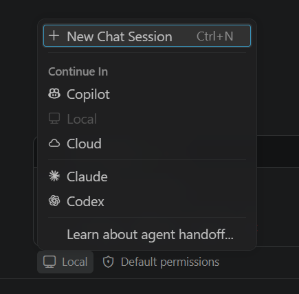

# GitHub Copilot Customization for QE: Hands-on with Playwright

## Introduction

This track teaches the core GitHub Copilot customization concepts in VS Code, using a Playwright test project as the playground:

- instructions
- prompts
- skills
- agents

(Hooks and the Playwright MCP server are optional extras.)

The training app is **Skyline Air**, a small fictional flight-search site with a booking API. It runs on your machine, and all data is synthetic. The Playwright part is only there to make the concepts relevant to your work. **The learning goal is the Copilot primitives.**

Time: **45 minutes.** Complete [PRE-WORK.md](PRE-WORK.md) first, because there is no time for setup in the session. Open the `exercises/playwright` folder in VS Code (File &gt; Open Folder) so everything Copilot creates lands in this exercise.

## Completion criteria

You are done when you can demonstrate each of these:

- **Instructions:** Create an instructions file and use it in a request. Validated when Copilot's output follows your rules without being told.
- **Prompts:** Create and run a stored prompt. Validated when it runs and gives a repeatable result.
- **Skills:** Create and use a skill. Validated when it is picked up and returns a multi-step review.
- **Agents:** Create and use a custom agent. Validated when it writes tests, runs them and fixes problems end to end.

## Concepts


| #            | Concept      | What it does                             | Command                |
| ------------ | ------------ | ---------------------------------------- | ---------------------- |
| 1            | Instructions | Always-on guidance for Copilot           | `/create-instructions` |
| 2            | Prompts      | Reusable templates for repeated requests | `/create-prompt`       |
| 3            | Skills       | Reusable multi-step workflows            | `/create-skill`        |
| 4            | Agents       | End-to-end tasks: write, run, fix        | `/create-agent`        |
| 5 (optional) | MCP          | Lets the agent drive a real browser      | trainer demo           |
| 6 (optional) | Hooks        | Automatic checks after tool actions      | `/create-hook`         |


After you run a prompt or slash command, **watch Copilot's reasoning in Chat and wait for it to finish** before moving on. If your result differs from what is described, ask Copilot to explain, or ask the trainer.

**Where your files go.** Everything you create with `/create-…` must end up inside **this folder's** `.github/` (for example `.github/prompts/…`). Copilot sometimes creates the file in the `.github` folder at the repository root instead. If that happens, move the file into this folder's `.github`, in the same subfolder. Otherwise Copilot will not load it. To check, open the cog wheel menu in the Chat panel, choose **Customizations**, and look for your item under **Workspace**.

## Start (about 4 min)

Run the API test case (TC2):

```bash
npm run tc2
```

**Expected:** 1 test fails and 1 passes. The failing one is *"creates a confirmed booking with the correct total"*. Read the error. You will come back to it in Concept 2.

---

## 1. Create instructions (about 9 min)

*Instructions give Copilot standing rules so you don't repeat them in every prompt.*
More information: [Custom Instructions](https://code.visualstudio.com/docs/copilot/customization/custom-instructions)

Goal: Copilot always follows our Playwright team standards.

**Create:**

- In Copilot Chat, type:

```text
/create-instructions Playwright QE rules for TypeScript files:
                     import test and expect from tests/fixtures, never from @playwright/test.
                     API tests use the typed clients in the fixtures, never raw fetch.
                     Locators live in page objects, none in specs.
                     No waitForTimeout. Never weaken an assertion.
                     Every test has at least one tag, like @api.
                     Only apply to TypeScript files.
                     Save it in this folder's .github/instructions, not the repo root.
                     Name it `qe-playwright-rules`
```

- Press Enter. If Copilot asks a clarifying question, answer briefly (for example "any tags, at least one") and let it finish.
- Open `.github/instructions/qe-playwright-rules.instructions.md` and review it. It should be listed under **Workspace** in Customizations &gt; Instructions.
- Check it applies only to TypeScript via `applyTo: "**/*.ts"` (visible in the editor, not in Markdown preview).

**Execute:**

- Close any open spec files first, so Copilot has no existing test to copy. Whatever it follows now comes from your instructions.
- In Copilot Chat, type:

```text
Create a new spec tests/api/booking-validation.spec.ts that tests booking validation:
a blank passenger name (only spaces), and an unknown flight
```

**Verify:**

- Open the new file and confirm it follows your rules even though the prompt didn't mention them:
  - it imports `test` and `expect` from `../fixtures` (not `@playwright/test`)
  - it uses `bookingsApi` (not `fetch` or a raw request)
  - every test has a tag
  - it asserts the status code and the error body (`400` for the blank name, `404` for the unknown flight)
- Click **Keep**, then run 
  ```text 
  npx playwright test tests/api/booking-validation.spec.ts
  ``` 
  The new tests should pass.
- Copilot may offer to fix the failing booking-total test (TC2). **Decline for now.** That is Concept 2.

---

## 2. Create a reusable prompt (about 9 min)

*Prompt files are stored slash commands for tasks you repeat.*
More information: [Prompt Files](https://code.visualstudio.com/docs/copilot/customization/prompt-files)

Goal: a repeatable way to triage any failing test.

**Create:**

```text
/create-prompt Triage a failing Playwright test. Run it, read the error, and decide
               whether the TEST is wrong or the PRODUCT is wrong, with evidence.
               Propose the smallest fix and the file it belongs in.
               Never add sleeps, skip the test, or weaken an assertion.
               Return: Verdict, Evidence, Proposed fix.
               Save it in this folder's .github/prompts, not the repo root.
               Name it `triage-failing-test`
```

- If Copilot asks where to create it, choose **Workspace**.
- Open `.github/prompts/triage-failing-test.prompt.md` and review it.

**Execute:**

- Open [tests/api/tc2-create-booking.spec.ts](tests/api/tc2-create-booking.spec.ts).
- In Copilot Chat, type:

```text
/triage-failing-test the booking total test in tc2-create-booking.spec.ts
```

**Verify:**

- The answer states a verdict and evidence.
- It points at the app (`app/server.js`, the total calculation), not the test.
- The prompt only diagnoses and does not change files. Send a follow-up message: `Apply the proposed fix`. Click **Keep**, then run `npm run tc2`. All the `@tc2` tests should now pass.

---

## 3. Create a skill (about 9 min)

*Skills are folders of instructions Copilot loads when relevant to run a multi-step workflow.*
More information: [Agent Skills](https://code.visualstudio.com/docs/copilot/customization/agent-skills)

Goal: a reusable review of API specs against team standards.

**Create:**

```text
/create-skill Review a Playwright API spec against our standards: fixtures imported,
              typed clients used, status and typed fields asserted, tags present,
              no waitForTimeout, synthetic data only.
              Sort the output into pass and fail, and suggest short fixes for fails.
              Format it nicely.
              Save it in this folder's .github/skills, not the repo root.
              Name it `api-test-review`
```

- If Copilot asks where to create it, choose **Workspace**.
- Open `.github/skills/api-test-review/SKILL.md` and review it. It should be listed under Customizations &gt; Skills.

**Execute:**

Close other spec files first, in a **new chat**, type:

```text
Review tests/api/tc2-create-booking.spec.ts
```

- Copilot infers the skill from your wording. If it doesn't use it, run `/api-test-review` explicitly.

**Verify:**

- The response groups findings into pass and fail.
- It names specific lines in the spec.
- Check for the expandable "Reviewed" section in the chat history showing the skill was used.

---

## 4. Create a custom agent (about 9 min)

*Custom agents are personas with their own instructions and tools that can complete multi-step tasks.*
More information: [Custom Agents](https://code.visualstudio.com/docs/copilot/customization/custom-agents)

Goal: an agent that writes missing API tests, runs them and fixes problems.

**Create:**

```text
/create-agent Agent that writes missing Playwright API tests for an area I name.
              It reads the existing typed clients and a similar spec first,
              writes the tests with the fixtures and tags, runs them, and checks the result.
              If a test fails it decides whether the test or the product is wrong and fixes the right one.
              Tag every new test @api. Never weaken an assertion. Summarise what it added and changed.
              Save it in this folder's .github/agents, not the repo root.
              Name it `api-test-writer`
```

- If Copilot asks where to create it, choose **Workspace**.
- Open `.github/agents/api-test-writer.agent.md` and review it. It should be listed under Customizations &gt; Agents.

**Execute:**

- In the agent selector (bottom of Chat), choose `api-test-writer`, and check its name is shown before you send.
- Type:

```text
cover the flights search API
```

**Verify:**

- A new spec appears under `tests/api/` using the fixtures, tagged `@api`.
- Look at the assertions. Are any too tightly tied to the current data, for example a whole list copied into `toEqual`? Discuss.
- The agent ran the tests itself and reported the result.
- Click **Keep**, then run `npm run api`. All API tests should pass. (`npm test` still shows the two TC1 UI tests failing. That is expected: they are the optional stretch.)

---

## Wrap-up (about 2 min)

Discuss with your group:

- Which of the four gave the most leverage, and why?
- What should become team-wide standards rather than personal preferences?
- How will you check Copilot-generated tests in real pull requests?

---

# Optional extras

## 5. Playwright MCP (trainer demo)

*MCP lets the agent use tools. The Playwright MCP server lets it drive a real browser.* The trainer demonstrates this on screen. Playwright MCP runs **locally**: VS Code starts it as a process on your machine and talks to it directly, with no server hosted anywhere.

To try it yourself:

1. **Start the demo app** in a terminal and leave it running: `npm start`. (The tests start the app for you, but the MCP browser does not.)
2. Copy [optional/mcp.json](optional/mcp.json) to `.vscode/mcp.json`.
3. Start the server from the file's **Start** link. If the **Start** link isn't there, close and reopen VS Code on the same `playwright` folder, then look again.
4. Ask the agent:

```text
Use only the Playwright MCP tools (no other browser). Open http://localhost:3100, search flights from SYD to MEL, and tell me what you see.
```

- A browser window opens on your laptop. That is the MCP server, a local process, driving a real browser.
- In Chat the tool calls appear as titles such as **Navigate to a URL**, **Page snapshot** and **Click**. Their raw names (`browser_navigate`, `browser_snapshot`, `browser_click`) are listed under Customizations &gt; Tools.
- To see the server itself, open the Command Palette, run **MCP: List Servers**, choose `playwright`, then **Show Output**.

Use only the local demo app. Never point it at real sites or production.

**When you have finished, stop the app.** Press `Ctrl+C` in the terminal where `npm start` is running. The tests reuse an app that is already running, so a leftover copy makes them run against old code. If you closed that terminal and port 3100 is still in use, stop whatever owns the port:

- Windows (PowerShell): `Get-NetTCPConnection -LocalPort 3100 -State Listen -ErrorAction SilentlyContinue | ForEach-Object { Stop-Process -Id $_.OwningProcess }`
- macOS and Linux: `lsof -ti :3100 | xargs kill`

## Stretch: UI test case (TC1)

Done early? Try the UI test case. You will see the failure with your own eyes first, then use **your own** prompt, skill and agent on it.

**Step 1. Watch it fail in a real browser:**

```bash
npm run tc1:headed
```

A browser window opens and runs the test in **slow motion**. Watch it load the Skyline Air page, pick Sydney, pick Melbourne, and then **stall**: it is waiting for a button it can't find, and about 15 seconds later the test times out and the window closes. The red error in the terminal is expected. Watch what the page shows and what the test is trying to click.

(For a timeline you can scrub through instead, run `npm run tc1:ui` and click a test. Close the window when you are done. Or, in the Testing view, tick **Show browser** and run the test from there.)

**Step 2. Look at what Playwright captured:**

```bash
npm run report
```

The HTML report opens. Open the failed test and look at:

- the **error**: `waiting for locator('#search-btn')`
- the **screenshot** of the page at the moment of failure
- the **trace**: click through the actions. It shows each step, the page at that moment, and the click that never found its target.

Also open `test-results/<failed test folder>/error-context.md`. Playwright writes it for you: the error plus a **snapshot of the page's real controls**. Look for the search button there. What is it actually called?

**Step 3. Triage it with Copilot.** Attach that `error-context.md` file as context (the paperclip, or drag it into Chat), then:

```text
/triage-failing-test the flight search tests in tc1-flight-search.spec.ts
```

- **Verdict:** is the test wrong, or the page? How does the evidence show it?
- **Where should the fix go?** Page object, spec or app?
- Apply the fix, click **Keep**, and run `npm run tc1`. Copilot may find a second stale locator when it runs the tests and fix both. If not, fixing one locator can reveal another failure: go round again.
- Review the result with your skill: `Review tests/e2e/tc1-flight-search.spec.ts`.

## 6. Hook (optional)

*Hooks run a command automatically at a point in an agent session.*
More information: [Agent hooks](https://code.visualstudio.com/docs/copilot/customization/hooks)

**Use a Local chat for this exercise.** Hooks only run in **Local** chats. Before you send each prompt, check that the chip at the bottom left of the chat box says **Local** (not **Copilot** or **Cloud**). If it says **Copilot** or **Cloud**, click it and choose **Local**.



```text
/create-hook Post-tool hook named spec-quality: after edits to .spec.ts files only,
             scan the edited file and report any waitForTimeout or any test without a tag.
             Return the result as a systemMessage: ✅ if clean, ⚠️ with a plain list otherwise.
             Do not modify files. Support Windows and Unix paths.
             Save it in this folder's .github/hooks, not the repo root.
             The hook gets a JSON payload on stdin with tool_name and tool_input.
             Find the edited file in tool_input.filePath. For the apply_patch tool there is no
             filePath: read the paths from the patch text in tool_input.input, on the lines that
             start with "*** Update File:" or "*** Add File:".
             Use only Node built-ins. Do not add or change any dependencies. Keep it short.
```

- **Quit VS Code completely and reopen it.** Reload Window is not enough, or the hook won't fire. Reopen this folder.
- Start a new **Local** chat and ask: `In tests/api/tc2-create-booking.spec.ts, add a test with no tag that checks GET /api/health returns 200`. (If that test already exists, ask for a variable rename instead. Any edit to the spec triggers the hook.)
- Open the **Output** panel and choose **GitHub Copilot Chat Hooks** from the dropdown. After the edit you should see a `[PostToolUse]` entry that runs `spec-quality`, followed by its output, for example `⚠️ spec-quality … test without a tag`. **This is how you verify the hook ran.**
- Depending on your VS Code version, Chat may also show a "received a warning" row. If it does not, that is fine: the Output channel is the reliable check.

---

## Reset

To discard code changes and start over (run from this folder):

```bash
git status
git restore --staged .
git restore .
git clean -fd
```

Warning: `git clean -fd` permanently deletes untracked files in this folder.

The customization files you created live in `.github/`, which git ignores. To remove them too, delete the `.github` folder in this exercise.

## Troubleshooting

- Slash commands not showing: ensure Copilot Chat is active and type `/`.
- A hook does not run: use a **Local** chat, quit and reopen VS Code after creating the hook, and check **Output &gt; GitHub Copilot Chat Hooks**.
- A file you created is not picked up: it probably landed in the repo-root `.github`. Move it into this folder's `.github` (see **Where your files go**).
- Copilot reports `Denied by preToolUse hook`: a hook from another plugin or extension on your machine is failing and blocking Copilot's edits and commands. Disable or uninstall that plugin, reload VS Code, and try again.
- `/create-…` not available: make sure you're in **Agent** mode.
- Tests fail to start: confirm `npm run smoke` passes.
- Port 3100 is in use: a copy of the demo app is probably still running (for example from `npm start`). Stop it with `Ctrl+C` in its terminal. If that terminal is gone, use the commands at the end of the Playwright MCP section.

## Useful commands


| Command                       | What it does                                                  |
| ----------------------------- | ------------------------------------------------------------- |
| `npm run smoke`               | Environment check                                             |
| `npm run tc1` / `npm run tc2` | Run one test case                                             |
| `npm run api`                 | Run all API tests                                             |
| `npm test`                    | Run everything                                                |
| `npm run report`              | Open the HTML report                                          |
| `npm start`                   | Run the app at [http://localhost:3100](http://localhost:3100) |


